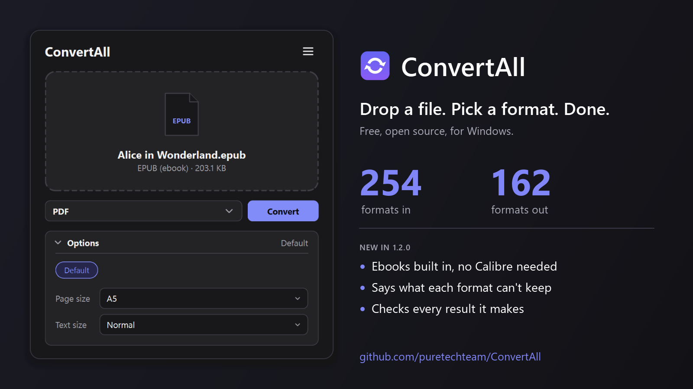
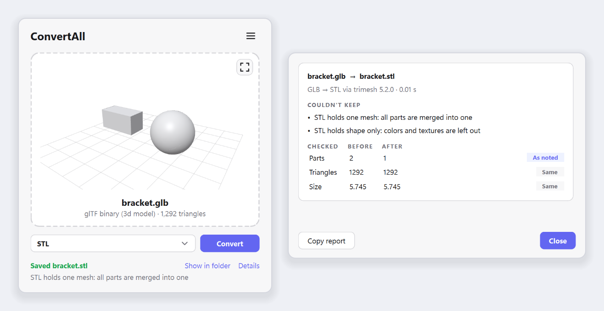

# ConvertAll

Convert, compress or extract any file. Drop it in, pick a format, done.

<p align="center">
  
</p>

What's new: see the [changelog](CHANGELOG.md).

## Just want the app?

Download **`ConvertAll-<version>-windows.zip`** from the [latest release](https://github.com/puretechteam/ConvertAll/releases/latest), unzip it, and run **`ConvertAll\ConvertAll.exe`**. Nothing to install.

Move the `ConvertAll` folder wherever you like. Keep `ConvertAll.exe` and its `_internal` folder together: the exe won't start without it.

## Using it

- **Window:** `ConvertAll.exe`. Drop files or folders on it, choose a format (the most common conversion for that file is already picked, and next time it remembers yours), click **Convert**. Archives also get **Extract here**. While it runs, **Convert** turns into **Cancel**; closing the window mid-conversion asks first, then stops it cleanly. Output lands next to the original and never overwrites (`photo (1).png`).
- **3D preview:** drop one 3D model or CAD part and it shows right in the window: drag to turn it, right-drag to move it, scroll to zoom. The expand button in its corner (or a double-click) opens it in a big window with a wireframe view and its size, parts, triangles and materials. Animated models play, in the preview and in the big window, where you can pause, scrub along the timeline, or pick which take to play; rigged characters bend and blend shapes change as they move. It shows every format below that ConvertAll can turn into a 3D model, textures and colors included.
- **What it keeps:** point at a format in the list to see the route it takes (*via PDF*) and what it can't keep, for example *"JPG has no transparency: see-through areas become white"* or *"STL holds one mesh: all parts are merged into one"*. After converting, the status line says the most important of those, and **Details** shows the whole report: the route and the tools that did each step, what was left out, and what ConvertAll checked on the result (see [What ConvertAll checks](#what-convertall-checks)). *Copy report* puts it on the clipboard.
- **Options and presets:** under the format there's a small **Options** card. Open it to set what the chosen format takes, and only that: quality (a slider) and maximum size for photos, resolution for PDF pages, video quality, size and frame rate, sound bitrate, mesh detail for CAD parts, and page size and text size for ebooks made into PDFs. Sizes, resolutions, frame rates and bitrates offer the usual values and take any other you type. Presets are one click (*Default*, *Smaller for email and web*, *Best quality*, *For phones and social*, *Ready for 3D printing*); set your own and *+ Save as preset* keeps them. Nothing set means ConvertAll's usual defaults; your choices are remembered, and the card's header says what's on.
- **Terminal:** `convertall-cli.exe` (or `convertall` when installed with pip).
- **Right-click:** in the window, go to ☰ → *Add to right-click menu*. Explorer then shows **Convert with ConvertAll** on files and folders, **Extract with ConvertAll** on archives (zip, rar, 7z, iso, tar.gz and the rest), which unpacks straight away (select several archives and they're extracted as one batch), and **View with ConvertAll** on 3D models and CAD parts, which opens just the viewer. On Windows 11 it's under *Show more options*. After an update, or if you move ConvertAll to another folder, the menu points to it again the next time you open it.
- **Start menu:** ☰ → *Add to Start menu*, then type "ConvertAll" in Start to open it.

## Help and chat

Questions, a file that won't convert, an idea, or just want to talk about it? Join us on **[Discord](https://discord.gg/dRMRGCG9Fk)**. It's also in the window, under ☰ → *Help and chat on Discord*.

## What it handles

| Kind | Formats | Engine |
|---|---|---|
| Images | png jpg webp gif bmp tiff ico heic avif jp2 tga qoi dds icns pcx ppm sgi xbm psd cur xpm, all to each other; any picture → **svg** (traced into vector shapes); svg/svgz and pdf-compatible ai → images/pdf; pdf → svg | built in ([vtracer](https://github.com/visioncortex/vtracer) for tracing) |
| PostScript | eps ps → pdf (and on to images, svg, dxf); pdf → eps/ps; images → eps | Ghostscript (images → eps built in) |
| Windows metafiles | emf wmf → png/svg/pdf | LibreOffice |
| Camera RAW, GIMP, HDR, JPEG XL | dng cr2 cr3 nef arw orf rw2 raf xcf exr hdr jxl | ImageMagick |
| Audio | mp3 wav flac ogg opus m4a m4b m4r (iPhone ringtone, first 40 s) aac wma aiff ac3 amr mka wv caf mp2 au, plus ape dsf dff (DSD) in | FFmpeg |
| Video | mp4 mkv webm mov avi wmv flv f4v asf vob m4v mpg ts 3gp ogv, plus mxf rm rmvb 3g2 in; video → gif, animated webp or audio | FFmpeg |
| Subtitles | srt vtt ass ssa sbv (YouTube) sub (MicroDVD) ttml/dfxp smi (SAMI), all to each other; pull the subtitle track out of a video | built in ([pysubs2](https://github.com/tkarabela/pysubs2); FFmpeg for videos) |
| Office | docx doc odt rtf pages wps hwp (+ docm dotx dot), xlsx xls ods numbers csv dbf (+ xlsm xlsb xltx), pptx ppt odp key (+ pptm ppsx pps potx) → pdf and each other; pdf → docx; html → docx/odt/rtf | LibreOffice |
| Drawings | vsdx vsd (Visio), pub (Publisher), odg, cdr (CorelDRAW) → pdf/png/svg | LibreOffice |
| PDF | pdf → images (one folder per multi-page doc), pdf → txt, images/txt/html/md → pdf, xps → pdf | built in |
| Markdown & HTML | md → html, html → md, docx → html/md (md ↔ docx chains through html); mht/mhtml saved pages → html/pdf; Jupyter ipynb → md/html (and on to pdf/docx) | built in (+ LibreOffice for → docx) |
| Markup languages | tex (LaTeX), rst, org, adoc (AsciiDoc), wiki (MediaWiki) ↔ md html docx odt epub | Pandoc |
| Scanned books | djvu → pdf (and on to images), djvu → txt (its OCR layer) | DjVuLibre |
| Comics | cbz cbr cb7 cbt → pdf (pages kept as they are, in reading order), between each other, and pdf → cbz/cb7/cbt; a folder of images → pdf or cbz. Renamed comics (a "cbr" that's really a zip) are detected by content | built in (7-Zip for real RAR comics) |
| Ebooks | epub mobi azw3 azw fb2 fbz lit pdb lrf htmlz txtz pml pmlz rb tcr snb, all to each other, and chm in; ebooks → pdf (page size and text size as settings), docx, rtf, html, md, txt; html/docx/odt/rtf/md/txt and pdf → ebooks; comics → fixed-layout epub/mobi/azw3 and the rest. Copy-protected (DRM) books are refused, never unlocked | built in ([bookport](https://github.com/puretechteam/bookport)) |
| Email | eml and Outlook msg → pdf/html/txt: headers, the message (with its inline pictures) and a list of attachments | built in |
| Maps & GPS | gpx kml kmz geojson, all to each other; → csv (one row per point) | built in |
| Contacts & calendars | vcf (vCard) ↔ csv/json, ics (iCalendar) ↔ csv/json; Google and Outlook CSV exports are understood | built in |
| 3D models | stl obj ply off glb gltf 3mf dae fbx 3ds usd usdz abc, all to each other, and Blender's blend → all of them (parts, colors and textures kept where the format can hold them). FBX: binary and ASCII, 2006 onward; textures are found even when the file points at another PC. USD: usda, usdc and usdz, with references, payloads and variants. Alembic: the Ogawa kind (2013 onward). blend: Blender 2.8 onward (checked with 2.83, 2.93, 3.3, 3.5 and later), with modifiers, curves, text and metaballs as Blender shows them. Animation is kept between FBX, glTF, USD and Alembic, and read from 3DS and blend; skeletons (skinning) and blend shapes between FBX, glTF and USD, and from blend | built in ([meshport](https://github.com/puretechteam/meshport) for FBX, 3DS, USD, Alembic and blend) |
| CAD | step/stp, iges/igs, brep → watertight stl (and from there any mesh format); dxf → svg/pdf/png; svg/pdf vector drawings → dxf (for laser cutters) | built in |
| Medical | DICOM (.dcm or no extension) → png/jpg/tiff/… with the scanner's display window applied; multi-frame → folder, gif or multi-page tiff/pdf; header → json | built in |
| Data | json jsonl yaml toml xml ini plist csv tsv xlsx sqlite, all to each other | built in |
| Fonts | ttf otf woff woff2, all to each other (TrueType and CFF outlines converted as needed); ttc collections → their fonts | built in |
| Archives | create zip 7z rar tar tar.gz tar.bz2 tar.xz tar.zst tar.lz4 gz bz2 xz zst lz4 br lzma z cpio iso wim from **any file or folder**; extract all of those plus cab arj lzh dmg rpm deb ar msi msp xar/pkg vhd vhdx vmdk vdi qcow2 img squashfs udf apfs hfs zipx, split archives (.001, .r00), and zip-based packages (jar war ear apk aab ipa xpi crx vsix nupkg whl appx msix); repack any archive into another | built in ([packport](https://github.com/puretechteam/packport) for rar, z and cpio), 7-Zip for disk images, wim etc. |

When there's no direct conversion, ConvertAll chains steps automatically, for example docx → pdf → png, fbx → glb → 3mf, or step → stl → glb. If a step needs an engine that's missing, ConvertAll offers a one-time install right from the window (with `winget`; Ghostscript, which winget doesn't carry, is downloaded from its official release and unpacked into ConvertAll's own folder). Check engine status with ☰ → *Engines…* or `convertall engines`.

STL and 3MF are written Z-up (and read as Z-up), so models stand upright in 3D-printing slicers. The other 3D formats are Y-up.

Photos keep their details (camera, date, place: EXIF) and color profile when the new format can hold them (jpg png webp tiff heic avif); the picture is turned upright first, so it no longer needs its rotation flag. A file named for the wrong format (a JPEG saved as `.png`, which happens a lot with downloads) is converted as what it really is, and the report says so.

Some outputs come back as a **folder**: multi-page PDFs and multi-frame DICOMs saved as single-image formats, plus OBJ and USD models that have textures or materials (stored as side files).

Extracting is careful with archives from the internet: nothing lands outside the folder, links are left out, names Windows can't hold are renamed the way 7-Zip does, files never overwrite each other (`a (1).txt`), and an archive that would fill the disk stops before it does. Anything left out is reported. Keep 7-Zip at 25.00 or newer: older versions have a known link flaw, which ConvertAll works around but points out.

Other files get the same care: a document may pull in pictures only from its own folder or one level up, Pandoc runs sandboxed so an include line can't copy another file into the result, FFmpeg reads local files only, and engines are never run from the current folder. See [SECURITY.md](SECURITY.md).

RAR and CBR are written *stored* (uncompressed) in the RAR 4 format every reader opens, the way comic packers make them anyway; RAR's own compression is proprietary. If WinRAR is installed, ConvertAll uses it instead and the archives come out compressed.

**Not supported:** DWG; Apple Pages/Numbers/Keynote, `.blend`, APE and RealMedia as *outputs* (no free writer exists; all of them can be read); Parquet (its library alone is 29 MB); Office macro and template variants (docm, dotx, xlsm, potx) as outputs; DICOMs compressed with *JPEG Lossless* (Process 14), which would need a 45–140 MB codec library.

## What ConvertAll checks

<p align="center">
  <picture>
    <source media="(prefers-color-scheme: dark)" srcset="screenshots/after_converting_dark.png">
    
  </picture>
</p>

Every conversion in the window, and every one from the command line, is checked afterwards: ConvertAll opens the result the way the next program would and compares what it can measure with the original. Only measured facts are shown, never a score.

| Kind | Measured before and after |
|---|---|
| Pictures | width, height, frames (and the length of an animation), transparency |
| PDF, XPS | pages (a folder of page images counts its images) |
| Audio, video | length (within half a second), sound tracks, picture size (needs FFmpeg) |
| 3D models | parts, triangles, size, animation, skeletons and blend shapes |
| Data, tables | tables (sheets), records |
| Subtitles, fonts | subtitles, glyphs (and the fonts in a collection) |
| Archives, comics | files, pages |
| Maps, contacts, DICOM | places and tracks, contacts and events, frames |
| Ebooks | words (within 3%), also when a book becomes a PDF, Word, RTF, HTML, Markdown or text file |

A difference the route said it would make (*Parts: 4 → 1*, for STL) is expected. Any other difference, or a result that doesn't open, is a warning: the file is kept, and the status line turns amber and says what didn't match. Files bigger than 200 MB aren't read again just to check them.

When there's more than one way to get there, ConvertAll takes the route that keeps the most, even when it is a step longer: an old Excel .xls or an OpenDocument .ods workbook goes to JSON through XLSX (every sheet) rather than through CSV (the first sheet only), and a Visio drawing to EPS through PDF (still vectors) rather than through PNG.

## Command line

```
convertall photo.heic --to png          # writes photo.png next to it
convertall *.wav --to mp3 -o out        # batch into a folder
convertall report.docx --list           # what can this become? (and the most common choice)
convertall issue1.cbr --to pdf          # comic -> PDF
convertall project --to 7z              # compress a folder
convertall archive.rar --extract        # unpack
convertall bracket.step --to stl        # CAD -> printable mesh
convertall view chair.fbx               # look at a 3D model, in a window
convertall engines [--install ffmpeg]

convertall clip.mov --to gif --plan     # the route, what it can't keep, the settings it takes; converts nothing
convertall *.jpg --to webp --preset "Smaller for email and web"
convertall scan.pdf --to png --dpi 300  # settings: --quality --max-size --dpi --video-quality --video-size --fps --bitrate --detail --page-size --text-size
convertall photo.png --to jpg --json    # one JSON report per file on stdout: route, steps, notes, checks, warnings
convertall photo.png --list --json      # every target as JSON: format, kind, route, engines it needs
convertall presets                      # the presets (yours too) and every setting
```

`-y` installs missing engines without asking. After each file, the notes and checks are printed under it. A setting only applies where the conversion takes it (`--quality` changes a JPG, not a PNG), and presets you save in the window work here too (they live in `%APPDATA%\ConvertAll\presets.json`). With `--json`, stdout holds only JSON, one object a line and always UTF-8: the report after converting, the plan with `--plan` (route, steps, notes, settings, what the route takes, engines it needs), the targets with `--list`. A file that fails gives `{"source", "error"}`, so scripts can read them; the exit code is 0 when everything converted, 1 when something failed and 2 for bad arguments.

From Python: `from convertall import convert, plan, extract, Report`; `convert(path, "jpg", report=Report(), options={"quality": 80})` returns the path written and fills in the report.

## Development

```
python -m venv .venv
.venv\Scripts\pip install -e .[dev]
.venv\Scripts\python -m convertall              # window
.venv\Scripts\python -m pytest                  # tests (engine tests skip if the engine is missing)
.venv\Scripts\python -m pytest tests\test_e2e.py --e2e   # every format -> every target it can reach (slow)
.venv\Scripts\ruff check .                      # lint
.venv\Scripts\python packaging\release.py       # build dist\ConvertAll\ and zip it for a GitHub release
.venv\Scripts\python packaging\bake_shaders.py  # after editing the 3D viewer's shaders (convertall\assets\shaders)
python packaging\make_icon.py                   # regenerate the icon
```

Adding a format means writing one function in `convertall/converters/` with
`@converter(inputs={...}, outputs={...}, engine=...)`. Routing, the CLI and the window pick it up automatically.

## License

MIT, see [LICENSE](LICENSE). ConvertAll calls FFmpeg, LibreOffice, ImageMagick, 7-Zip, Pandoc, DjVuLibre and Ghostscript as separate programs when they are installed; each keeps its own license.
