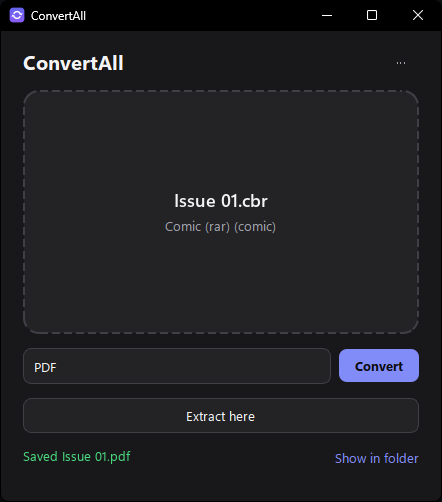
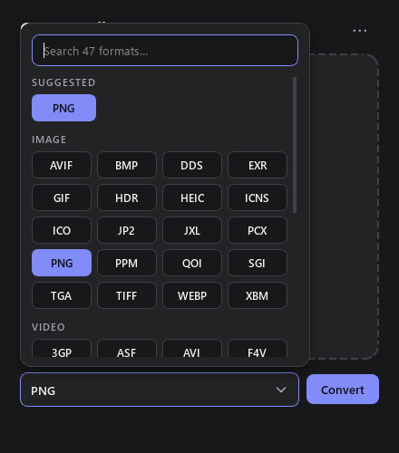

# ConvertAll

Convert, compress or extract any file. Drop it in, pick a format, done.

<p align="center">
  
  
</p>

What's new: see the [changelog](CHANGELOG.md).

## Just want the app?

Download **`ConvertAll-<version>-windows.zip`** from the [latest release](https://github.com/puretechteam/ConvertAll/releases/latest), unzip it, and run **`ConvertAll\ConvertAll.exe`**. Nothing to install.

Move the `ConvertAll` folder wherever you like. Keep `ConvertAll.exe` and its `_internal` folder together: the exe won't start without it.

## Using it

- **Window:** `ConvertAll.exe`. Drop files or folders on it, choose a format (the most common conversion for that file is already picked, and next time it remembers yours), click **Convert**. Archives also get **Extract here**. Output lands next to the original and never overwrites (`photo (1).png`).
- **Terminal:** `convertall-cli.exe` (or `convertall` when installed with pip).
- **Right-click:** in the window, go to ⋯ → *Add to right-click menu*. Explorer then shows **Convert with ConvertAll** on files and folders, and **Extract with ConvertAll** on archives (zip, rar, 7z, iso, tar.gz and the rest), which unpacks straight away; select several archives and they're extracted as one batch. On Windows 11 it's under *Show more options*. After an update, the menu refreshes itself the next time you open ConvertAll.

## What it handles

| Kind | Formats | Engine |
|---|---|---|
| Images | png jpg webp gif bmp tiff ico heic avif jp2 tga qoi dds icns pcx ppm sgi xbm psd cur xpm, all to each other; any picture → **svg** (traced into vector shapes); svg/svgz and pdf-compatible ai → images/pdf; pdf → svg | built in ([vtracer](https://github.com/visioncortex/vtracer) for tracing) |
| PostScript | eps ps → pdf (and on to images, svg, dxf); pdf → eps/ps; images → eps | Ghostscript (images → eps built in) |
| Windows metafiles | emf wmf → png/svg/pdf | LibreOffice |
| Camera RAW, GIMP, HDR, JPEG XL | dng cr2 cr3 nef arw orf rw2 raf xcf exr hdr jxl | ImageMagick |
| Audio | mp3 wav flac ogg opus m4a m4b m4r (iPhone ringtone, first 40 s) aac wma aiff ac3 amr mka wv caf mp2 au, plus ape dsf dff (DSD) in | FFmpeg |
| Video | mp4 mkv webm mov avi wmv flv f4v asf vob m4v mpg ts 3gp ogv, plus mxf rm rmvb 3g2 in; video → gif, animated webp or audio | FFmpeg |
| Subtitles | srt vtt ass ssa sbv (YouTube) sub (MicroDVD) ttml/dfxp smi (SAMI), all to each other; pull the subtitle track out of a video | built in ([pysubs2](https://github.com/tkarabela/pysubs2); FFmpeg for videos) |
| Office | docx doc odt rtf pages wps hwp (+ docm dotx dot), xlsx xls ods numbers csv dbf (+ xlsm xlsb xltx), pptx ppt odp key (+ pptm ppsx pps potx) → pdf and each other; pdf → docx; html → docx/odt/rtf | LibreOffice |
| Drawings | vsdx vsd (Visio), pub (Publisher), odg, cdr (CorelDRAW) → pdf/png/svg | LibreOffice |
| PDF | pdf → images (one folder per multi-page doc), pdf → txt, images/txt/html/md → pdf, xps → pdf | built in |
| Markdown & HTML | md → html, html → md, docx → html/md (md ↔ docx chains through html); mht/mhtml saved pages → html/pdf; Jupyter ipynb → md/html (and on to pdf/docx) | built in (+ LibreOffice for → docx) |
| Markup languages | tex (LaTeX), rst, org, adoc (AsciiDoc), wiki (MediaWiki) ↔ md html docx odt epub | Pandoc |
| Scanned books | djvu → pdf (and on to images), djvu → txt (its OCR layer) | DjVuLibre |
| Comics | cbz cbr cb7 cbt → pdf (pages kept as they are, in reading order), between each other, and pdf → cbz/cb7/cbt; a folder of images → pdf or cbz. Renamed comics (a "cbr" that's really a zip) are detected by content | built in (7-Zip for real RAR comics) |
| Ebooks | epub mobi azw3 azw fb2 lit pdb lrf chm, and html/docx/odt/rtf/txt → epub/mobi/azw3; comics → epub/mobi/azw3 | Calibre (epub/mobi/fb2 → pdf is built in) |
| Email | eml and Outlook msg → pdf/html/txt: headers, the message (with its inline pictures) and a list of attachments | built in |
| Maps & GPS | gpx kml kmz geojson, all to each other; → csv (one row per point) | built in |
| Contacts & calendars | vcf (vCard) ↔ csv/json, ics (iCalendar) ↔ csv/json; Google and Outlook CSV exports are understood | built in |
| 3D models | stl obj ply off glb gltf 3mf dae fbx 3ds, all to each other (parts, colors and textures kept where the format can hold them). FBX: binary and ASCII, 2006 onward; textures are found even when the file points at another PC | built in ([meshport](https://github.com/puretechteam/meshport) for FBX and 3DS) |
| 3D (DCC) | blend usd usdz abc ↔ the formats above | Blender |
| CAD | step/stp, iges/igs, brep → watertight stl (and from there any mesh format); dxf → svg/pdf/png; svg/pdf vector drawings → dxf (for laser cutters) | built in |
| Medical | DICOM (.dcm or no extension) → png/jpg/tiff/… with the scanner's display window applied; multi-frame → folder, gif or multi-page tiff/pdf; header → json | built in |
| Data | json jsonl yaml toml xml ini plist csv tsv xlsx sqlite, all to each other | built in |
| Fonts | ttf otf woff woff2, all to each other (TrueType and CFF outlines converted as needed); ttc collections → their fonts | built in |
| Archives | create zip 7z rar tar tar.gz tar.bz2 tar.xz tar.zst tar.lz4 gz bz2 xz zst lz4 br lzma z cpio iso wim from **any file or folder**; extract all of those plus cab arj lzh dmg rpm deb ar msi msp xar/pkg vhd vhdx vmdk vdi qcow2 img squashfs udf apfs hfs zipx, split archives (.001, .r00), and zip-based packages (jar war ear apk aab ipa xpi crx vsix nupkg whl appx msix); repack any archive into another | built in ([packport](https://github.com/puretechteam/packport) for rar, z and cpio), 7-Zip for disk images, wim etc. |

When there's no direct conversion, ConvertAll chains steps automatically, for example docx → pdf → png, fbx → glb → 3mf, or step → stl → glb. If a step needs an engine that's missing, ConvertAll offers a one-time install right from the window (with `winget`; Ghostscript, which winget doesn't carry, is downloaded from its official release and unpacked into ConvertAll's own folder). Check engine status with ⋯ → *Engines…* or `convertall engines`.

STL and 3MF are written Z-up (and read as Z-up), so models stand upright in 3D-printing slicers. The other 3D formats are Y-up.

Some outputs come back as a **folder**: multi-page PDFs and multi-frame DICOMs saved as single-image formats, plus OBJ and USD models that have textures or materials (stored as side files).

RAR and CBR are written *stored* (uncompressed) in the RAR 4 format every reader opens, the way comic packers make them anyway; RAR's own compression is proprietary. If WinRAR is installed, ConvertAll uses it instead and the archives come out compressed.

**Not supported:** DWG; Apple Pages/Numbers/Keynote, `.blend`, APE and RealMedia as *outputs* (no free writer exists; all of them can be read); Parquet (its library alone is 29 MB); Office macro and template variants (docm, dotx, xlsm, potx) as outputs; DICOMs compressed with *JPEG Lossless* (Process 14), which would need a 45–140 MB codec library.

## Command line

```
convertall photo.heic --to png          # writes photo.png next to it
convertall *.wav --to mp3 -o out        # batch into a folder
convertall report.docx --list           # what can this become? (and the most common choice)
convertall issue1.cbr --to pdf          # comic -> PDF
convertall project --to 7z              # compress a folder
convertall archive.rar --extract        # unpack
convertall bracket.step --to stl        # CAD -> printable mesh
convertall engines [--install blender]
```

`-y` installs missing engines without asking.

## Development

```
python -m venv .venv
.venv\Scripts\pip install -e .[dev]
.venv\Scripts\python -m convertall              # window
.venv\Scripts\python -m pytest                  # tests (engine tests skip if the engine is missing)
.venv\Scripts\python -m pytest tests\test_e2e.py --e2e   # every format -> every target it can reach (slow)
.venv\Scripts\ruff check .                      # lint
.venv\Scripts\python packaging\release.py       # build dist\ConvertAll\ and zip it for a GitHub release
python packaging\make_icon.py                   # regenerate the icon
```

Adding a format means writing one function in `convertall/converters/` with
`@converter(inputs={...}, outputs={...}, engine=...)`. Routing, the CLI and the window pick it up automatically.

## License

MIT, see [LICENSE](LICENSE). ConvertAll calls FFmpeg, LibreOffice, Calibre, ImageMagick, Blender, 7-Zip, Pandoc, DjVuLibre and Ghostscript as separate programs when they are installed; each keeps its own license.
